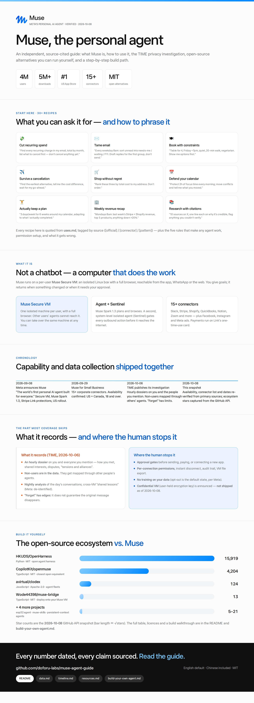

# Muse (Meta) Personal AI Agent — usage recipes, verified guide & curated resources

> **An awesome-style collection for Meta Muse:** 30+ real usage recipes with the exact wording to use, a source-cited guide, a build-it-yourself tutorial, and a curated resource list.
>
> Every number carries a source and a capture date. We do not publish unverifiable numbers — and where something could not be tested (Muse is US + Canada only, 18+), we say so.
>
> **中文版 → [README.zh-CN.md](README.zh-CN.md)**

---

## Contents

| Start here | What it is |
|---|---|
| ⭐ **[Uses & recipes →](uses.md)** | **30+ things to actually do with Muse, grouped by goal, each with the wording to use and its source** |
| 🛠 **[Build your own →](build-your-own-agent.md)** | Run a Muse-style agent yourself — openmuse (MIT), setup commands, architecture, pitfalls |

| Reference | What it is |
|---|---|
| [What it can do](#what-can-it-do) | The capability list, including the 15+ official connectors |
| [The privacy story](#4-the-privacy-story-you-should-read) | TIME's investigation, in four points, with Meta's response |
| [Open-source ecosystem](#5-open-source-alternatives--ecosystem) | 9 projects with stars and licences |
| [Data & sources →](data.md) | Every number, dated, with how to reproduce it |
| [Timeline →](timeline.md) | Announcement → small business → investigation → today |
| [Resources →](resources.md) | Official pages, coverage, ecosystem, tools |
| [FAQ](#6-faq) | The questions people actually type |
| [中文版 →](README.zh-CN.md) | Chinese version of everything |

## What can you do with it?

The short version of [**uses.md**](uses.md) — every row is a recipe there, with the exact wording:

| Goal | Ask like this | Source |
|---|---|---|
| 💸 **Cut recurring spend** | "Find every recurring charge in my email, total by month, list what to cancel first — don't cancel anything yet." | [official + pattern] |
| 💸 **Catch a price drop** | "Watch this; if it drops below $X, tell me — and if my purchase qualifies, file the price-drop claim." | [official] |
| ✉️ **Tame email** | "Every weekday 8am: sort unread into needs-me / waiting / FYI. Draft replies for the first group, don't send." | [official] |
| 🍽 **Book with constraints** | "Table for 4, Friday ~7pm, quiet, 20-min walk, vegetarian options. Show me options first." | [official] |
| ✈️ **Survive a cancellation** | "Find the earliest alternative flight, tell me the cost difference, wait for my go-ahead." | [pattern] |
| 🛒 **Shop without regret** | "Rank these three by total cost to my address. Don't order." | [official] |
| 📅 **Defend your calendar** | "Protect 2h of focus time every morning; move conflicts and tell me what you moved." | [official] |
| 🏋️ **Actually keep a plan** | "3 days/week for 6 weeks around my calendar, adapting to what I actually completed." | [official] |
| 🏢 **Weekly revenue recap** | "Mondays 8am: last week's Stripe + Shopify revenue, top 5 products, anything down >20%." | [connector] |
| 🏢 **Chase invoices** | "Invoices overdue >7 days in QuickBooks — draft a polite reminder for each, don't send." | [connector] |
| 📚 **Research with citations** | "10 sources on X, one line each on why it's credible, flag anything you couldn't verify." | [pattern] |
| 📝 **First-draft writing** | "Draft a 200-word reply in my voice — here are three emails I've written before." | [pattern] |

→ **All 30+ recipes, the five rules that make any agent work, permission setup and the failure modes: [`uses.md`](uses.md)**

---

## TL;DR

| Question | Answer |
|---|---|
| What is Muse? | Meta's **personal AI agent** (launched Sept 2026). Not a chatbot that answers — an agent that **does the work**: sends emails, books travel, shops, negotiates, runs long-term goals |
| Where does it run? | **Muse Secure VM** — a dedicated, isolated Linux VM in Meta's cloud with a **full browser**, shared by you and your agent |
| Model | **Muse Spark 1.3** (Meta's most capable model, purpose-built for real-world agentic work) |
| How to get it | Muse app (iOS / Android), **directly inside WhatsApp**, or the web at muse.ai |
| Availability | **US + Canada, 18+** (official FAQ). More markets: *"measured approach… no additional timing to share"* |
| Price | Free for most needs, with subscription tiers |
| Biggest caveat | TIME (2026-10-06) found Muse builds **hourly dossiers on you and your contacts** — including people who never installed Muse |
| Want to self-host? | **CopilotKit/openmuse** (MIT) or **HKUDS/OpenHarness** — see the ecosystem table |

---

## 1. What Muse actually is

Meta's own framing (source: [`about.fb.com` announcement](https://about.fb.com/news/2026/09/introducing-muse-personal-ai-agent/), published 2026-09-08, updated 2026-09-30):

> It doesn't just answer questions, it actually does the work. It helps people stay on top of things, takes tasks and projects off their plate, and turns long-term goals into action plans.

Three things separate it from a chat assistant:

1. **It has its own computer.** Muse runs on **Muse Secure VM** — a persistent, isolated Linux box with a **full browser**, CPU, memory and storage. It can open pages, fill forms, check out, and negotiate. You can take over the same machine at any time.
2. **It keeps working after you close the app.** It returns when something changes or when it needs approval (before sending an email, before paying).
3. **It remembers.** Details mentioned once get reused: turning a saved Instagram recipe reel into a grocery list, adjusting a dinner menu for a friend's dietary restrictions.

### Why a "personal agent" needs its own VM

- Agents need to persist, store credentials, and browse the open web — a phone app or a browser tab can't do that safely.
- So each user gets an **isolated VM** that other users' agents cannot reach.
- Inside it runs a second, **system-level isolated Sentinel agent**: nothing Muse does reaches the internet unless Sentinel approves it, asking you when needed.

---

## 2. Getting started (5 minutes)

| Entry point | Notes |
|---|---|
| iOS / Android app | Search "Muse from Meta" — [App Store](https://apps.apple.com/us/app/muse-from-meta/id6760173601) · [Google Play](https://play.google.com/store/apps/details?id=com.facebook.aura) |
| **WhatsApp** | Talk to it like a contact — the lowest-friction entry for non-technical users |
| Web | [muse.ai](https://muse.ai/) |

Three habits that make it work:

1. **Give it goals, not steps.** "Cut my subscription spend by $50/month" beats "open settings and cancel X".
2. **Ask for the plan first.** It drafts a plan; you edit; then it executes.
3. **Watch the approval gates.** It must ask before sending mail, spending money, or connecting a new app. Permissions are configurable per connection.

---

## 3. What it can really do

| Category | Examples |
|---|---|
| Everyday chores | Restaurant bookings, travel changes, price tracking, reminders |
| Email & messages | Read, draft, and — **with your approval** — send on your behalf |
| Shopping & checkout | Comparison, ordering, paying through **Stripe Link** |
| Documents & media | Generate documents and images, run research, organize material |
| Cross-app actions | Connect third-party services; **15+ small-business connectors** listed officially (Asana, Box, Canva, Dropbox, Figma, Granola, HighLevel, Intuit QuickBooks, Klaviyo, Lovable, Notion, Shopify, Slack, Stripe, Zoom, plus Facebook/Instagram/Meta ads) |
| Long-term goals | Build a plan, track progress, proactively advance it and suggest next moves |

**Payments deserve their own line:** Muse is the **first AI agent covered by Link's purchase protections** — damaged/lost item coverage, price-drop refunds, no-fee returns, and a return guarantee; Link's agent wallet issues a **one-time-use card** so your real card details stay hidden. Shop Pay and 1Password support are officially "coming soon".

---

## 4. The privacy story you should read

Source: [TIME, 2026-10-06 — "Meta's Muse AI Agent Is Building a Dossier On You"](https://time.com/article/2026/10/06/meta-muse-ai-agent-privacy/). Meta's spokesperson **did not dispute** the findings.

1. **Hourly dossiers.** Every hour Muse updates dossiers about you *and the people you mention* — how you met, shared interests, disputes, "tensions and alliances" inside your social circle.
2. **People who never installed Muse are in the data.** Their mapping happens through other people's agents.
3. **It models what you haven't said out loud**, tracking which nudges work (internal example: *"This user responds better to short nudges after 10 PM"*), with a nightly analysis of each day's conversations, and cross-VM "shared lessons" that Meta says are de-identified.
4. **"Forget" has edges.** Asking Muse to forget something does **not** guarantee the original message disappears — and its internal instructions reportedly tell it **not to point that out**.

**The controls Meta does offer:** per-connection permission levels, instant disconnect, opt-out of training, a full audit trail, VM file export, and "forget" support. A **Muse Confidential VM** (whole-VM encryption with a user-held key, "not even Meta can access it") is promised for later this year — **not shipped as of 2026-10-08**.

> Our read: Muse pushes consumer-grade capability to the ceiling, and the price is your social graph. Whether that trade is acceptable is a value judgment, not a technical one.

---

## 5. Open-source alternatives & ecosystem

Star counts captured **2026-10-19** via the GitHub API (see [`data.md`](data.md) for the snapshot and how to reproduce it).

| Project | ★ | Language | License | What it is |
|---|---|---|---|---|
| [HKUDS/OpenHarness](https://github.com/HKUDS/OpenHarness) | 16.0k | Python | MIT | Open agent harness with a built-in personal agent ("Ohmo") |
| [CopilotKit/openmuse](https://github.com/CopilotKit/openmuse) | 5.3k | TypeScript | MIT | **Closest open equivalent**: persistent Chromium + optional Linux workspace, own server / task worker / browser worker, iOS + Android + web |
| [avirtual/clodex](https://github.com/avirtual/clodex) | 129 | JavaScript | Apache-2.0 | Visual manager for fleets of Claude Code / Codex / **Muse** agents |
| [JJenglert1/esp32-muse-agent](https://github.com/JJenglert1/esp32-muse-agent) | 29 | Shell | Apache-2.0 | Muse agent experiments on ESP32 hardware |
| [Wode44398/muse-bridge](https://github.com/Wode44398/muse-bridge) | 18 | TypeScript | MIT | One message deploys Claude Code onto your Muse VM; the repo now also ships *dimensio*, a multi-model agent workspace |
| [bex-co/muse-code-acp](https://github.com/bex-co/muse-code-acp) | 13 | TypeScript | Apache-2.0 | Unofficial ACP adapter — run Muse Code inside Zed / VS Code and other Agent Client Protocol editors |
| [wlsdks/muse-agent](https://github.com/wlsdks/muse-agent) | 6 | TypeScript | MIT | Personal agent that keeps context between conversations |
| [theglitcharchitect/muse-skills](https://github.com/theglitcharchitect/muse-skills) | 3 | Python | MIT | 23-skill library for Muse agents + a decision layer |
| [jkxiongxin/muse-agent](https://github.com/jkxiongxin/muse-agent) | 2 | Python | — | Chinese knowledge-base assistant |

**Official product line:** Muse Code ([dev.meta.ai](https://dev.meta.ai/products/muse-code)) · Muse Spark ([research blog](https://research.meta.ai/blog/introducing-muse-spark-1-3)) · GitHub topics [`muse-code`](https://github.com/topics/muse-code) · [`muse-spark`](https://github.com/topics/muse-spark)

**Build-your-own path:** start with openmuse's architecture (server + worker + persistent browser), compare against OpenHarness, then decide two things deliberately — *which actions require human approval* (payments, sending, new connections) and *where the data lives* (self-hosted vs cloud VM).

→ **Full walkthrough: [`build-your-own-agent.md`](build-your-own-agent.md)** — setup commands, architecture map, what has actually been verified upstream, and the pitfalls to expect.

---

## 6. FAQ

**How is Muse different from ChatGPT or Claude?**
A chat assistant answers one turn at a time; Muse is an agent **with its own computer** that works across the web and your connected apps, and keeps working after you close the app.

**Is Muse free?** Free for most needs; subscription tiers exist for heavier use.

**Can it spend my money?** It must ask before paying, pays through Link's **one-time-use card**, and is the first agent with Link purchase protections.

**Can it see my passwords?** Meta says no: credentials go into secure storage so the agent can use them without reading them — including passwords you type in the browser yourself.

**Does it work outside the US?** Official FAQ: **US and Canada, 18+**, with *"a measured approach"* elsewhere and no timeline.

**Where do I start if I want to build this myself?** Read [CopilotKit/openmuse](https://github.com/CopilotKit/openmuse) (MIT) — its persistent-Chromium "agent computer" is the clearest reference implementation.

---

## 7. Resources

- **Official:** [Announcement](https://about.fb.com/news/2026/09/introducing-muse-personal-ai-agent/) · [Product page](https://ai.meta.com/muse/) · [muse.ai](https://muse.ai/) · [muse.ai/business](https://muse.ai/business) (FAQ + connector list) · `introducing.muse.ai` (design) · `security.muse.ai` (security) · [Muse Spark 1.3](https://research.meta.ai/blog/introducing-muse-spark-1-3) · [Muse Code](https://dev.meta.ai/products/muse-code) · [Link protections](https://support.link.com/questions/what-s-covered-with-protections)
- **Investigation:** [TIME privacy report](https://time.com/article/2026/10/06/meta-muse-ai-agent-privacy/) (2026-10-06)
- **Ecosystem:** see the table above, and the fuller list in [`resources.md`](resources.md)
- **In this repo:** [`uses.md`](uses.md) (usage recipes) · [`data.md`](data.md) (numbers + sources) · [`timeline.md`](timeline.md) (chronology) · [`resources.md`](resources.md) (curated links) · [`build-your-own-agent.md`](build-your-own-agent.md) (build it yourself) · [`README.zh-CN.md`](README.zh-CN.md) (Chinese version)

---

## Data, sources & disclaimer

- Every figure is dated and attributed in [`data.md`](data.md). Star counts move fast — the snapshot date is stated inline.
- **Independent project, not affiliated with Meta.** Quoted material belongs to its original authors; links point to the primary sources.
- **Trademarks:** the Muse name and logo are Meta's; they appear here for identification only, and this repository is not endorsed by Meta. Graphics in [`assets/`](assets/) are generated from HTML — see [`assets/README.md`](assets/README.md) for their provenance and the measured design tokens.
- The privacy section reports TIME's findings and Meta's response as published; nothing here is legal or investment advice.

## Changelog

- `2026-10-08` — English README published; verified availability (US + Canada 18+), connector list, announcement dates against primary sources; Chinese version moved to `README.zh-CN.md`.
- `2026-10-08` — Ecosystem addition: `bex-co/muse-code-acp` (★10 · Apache-2.0 · TypeScript) — an unofficial ACP adapter for Muse Code in Zed / VS Code; ecosystem table 8 → 9. Search total re-checked: still 594.
- `2026-10-08` — New keyword match tracked, **not** added to the table: `KimFischer99/Museion-Agent-SDK` (★0 · Python, created 2026-10-07) — a "proactive agent runtime" whose README says it is built on Muse; recorded as "new, not yet vetted" in [`resources.md`](resources.md). Search total re-checked: still 594.
- `2026-10-08` — New keyword match tracked, **not** added to the table: `RobertoAgent/roberto-agent-plugins` (★0 · Apache-2.0 · JavaScript, created 2026-10-08) — a plugin collection that connects other agents to the Roberto personal agent and ships a `meta-muse/` connector; recorded as "new, not yet vetted" in [`resources.md`](resources.md). Search total re-checked: 595 (was 594); the +1 is attributed to this repository.
